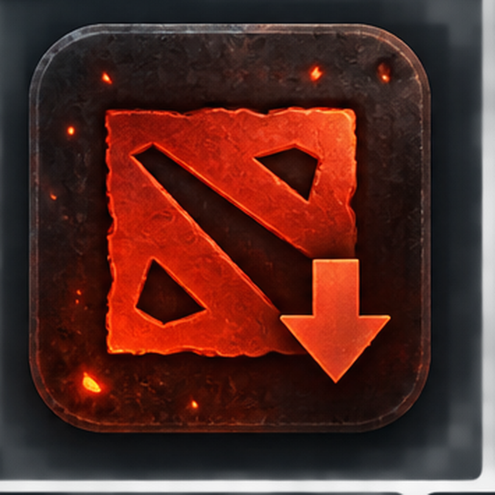

# Dota 2 Asset Studio



A lightweight Windows desktop tool for downloading and organizing Dota 2 hero, item, and neutral-creep images using Liquipedia Commons as the image source.

## Features

- Download hero portraits
- Download item images
- Download neutral-creep images
- Uses a simple Windows Tk/ttk interface
- Caches catalog data locally to reduce repeated requests
- Keeps downloaded assets separated by category
- Includes automated Windows builds through GitHub Actions

## Requirements

- Windows 10/11
- Python 3.12
- Internet connection for fetching asset data and images

## Run from source

```powershell
python -m pip install -r requirements.txt
python main.py
```

## Build the Windows executable

Run:

```bat
build_exe.bat
```

The executable is generated as:

```text
dist/Dota2AssetStudio.exe
```

The same build is also available through the GitHub Actions workflow when a `v*` tag is pushed.

## Project structure

```text
Dota2AssetStudio/
├── app/                    # Application code
├── tests/                  # Automated tests
├── .github/workflows/      # GitHub Actions build workflow
├── assets/                 # Project artwork and icons
├── heroes.txt              # Starter hero list
├── items.txt               # Starter item list
├── neutral_creeps.txt      # Starter neutral-creep list
├── main.py                 # Application entry point
├── requirements.txt        # Python dependencies
└── build_exe.bat           # Local Windows build script
```

## Tests

```powershell
python -m pytest -q
```

## Notes

The application stores runtime cache data in `cache/` and downloaded files in `output/`. These folders are intentionally excluded from version control.

Image and game assets are provided through external sources and remain subject to their respective licenses and rights. Dota 2 is a trademark of Valve Corporation.
